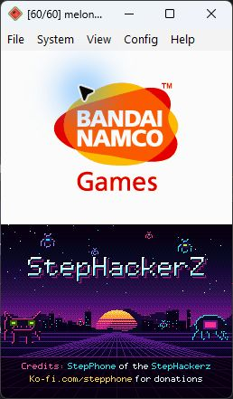
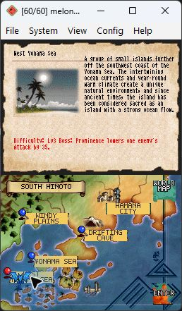

# Dragon Tamer: Sound Spirit — English Translation

By **StepPhone of the StepHackerZ**. **v0.1-beta — test release.**

An unofficial English translation patch for **Dragon Tamer: Sound Spirit (Japan)** on Nintendo DS, game code **AGOJ**. Supply your own clean Japanese ROM. No ROM, emulator, BIOS, or save is included.

## Download and patch

**[Download the patch ZIP](https://github.com/StepPhone/dragon-tamer-sound-spirit-english/releases/download/v0.1-beta/Dragon-Tamer-Sound-Spirit-English-v0.1-beta.zip)** · [Release notes](https://github.com/StepPhone/dragon-tamer-sound-spirit-english/releases/tag/v0.1-beta)

1. Extract the download to get the `.bps` patch.
2. Open [Rom Patcher JS](https://www.marcrobledo.com/RomPatcher.js/).
3. Select your **clean Japanese .nds ROM** and the **.bps patch**. Extract your ROM from its ZIP first.
4. Apply the patch. For existing development saves, keep the name `Dragon Tamer - Sound Spirit (English Full Text Draft).nds`.
5. Open the patched ROM normally and choose **Continue** to load your in-game save.

No Python or translation tools are needed to play. Use the release ZIP above rather than GitHub's automatic source-code downloads. Apply updates to the original Japanese ROM, not an already patched copy. Old emulator save states can retain previous code and text; restart the ROM after updating. Back up your save and preserve its matching base filename.

## Included in this beta

- English story, menus, help, item descriptions, battle callouts, dragon names, and Dragon Force names.
- Dialogue word wrapping and continuation pages that preserve the full text.
- 101 encyclopedia descriptions, 58 wrapped map descriptions, score titles, and translated staff-credit text.
- English interface graphics with clearer pixel lettering and original button artwork retained.
- Player-name handling fixes and English team-list headings and element labels.
- Native 256×192 **StepHackerZ boot credits**, matching the Zoids translation projects.




## Supported ROM

Both source and output are **67,108,864 bytes (64 MiB)**.

| File | SHA-256 |
| --- | --- |
| Clean Japanese source | `94af217b500a13b483fa2f0db42e63b93ca0c1481f471af3289dc6bd78acc3a1` |
| Patched v0.1 beta | `09075092373cc7be3b7a341f66bc688e6ea7f5d929032578df207bbc546b8559` |

On Windows, use `Get-FileHash -Algorithm SHA256 'Dragon Tamer - Sound Spirit (Japan).nds'` to check the source. Patch checksum: [SHA256SUMS.txt](SHA256SUMS.txt).

## Testing and limitations

The BPS patch reproduces the tested English ROM byte for byte. The file audit covered 471 named game files and 1,090 image/palette entries. Emulator checks across development include boot credits, title, Continue, story pages, selected menus and battles, encyclopedia text, and the reported map overlap.

This remains a **beta**. Some translations are machine-assisted drafts that need further review, and some staff-name romanizations are provisional. A complete campaign playthrough, physical DS hardware, and two-system wireless play have not been tested. Further missed Japanese, translation errors, or layout issues may remain. Japanese character-entry options and internal developer/debug data are not a promise of complete English coverage.

See [verification.json](verification.json) for release checks. Please report problems so they can be corrected.

## Build from source

Windows is required by the current graphics tools, which use installed Windows fonts. Install Python and dependencies, then provide your own clean ROM or ZIP:

```powershell
python -m pip install -r requirements.txt
python rebuild.py "C:/path/to/Dragon Tamer - Sound Spirit (Japan).nds"
```

The wrapper checks the source checksum, extracts local assets, builds the full draft, verifies the BPS round trip, and checks that the ROM and patch match this release. Outputs are the English ROM in the repository root and the patch under `builder/release/`. Generated ROMs and extracted assets are ignored by Git. No translation API or account is required.

## Report an issue

[Open an issue](https://github.com/StepPhone/dragon-tamer-sound-spirit-english/issues/new/choose) with the release version, emulator/version or hardware, location, steps to reproduce, and a screenshot if helpful. State whether you used New Game, Continue, or an emulator save state. Do not attach ROMs, BIOS files, or extracted game files.

## Credits

Translation project: **StepPhone of the StepHackerZ**, with AI-assisted translation and tooling. [Support StepPhone](https://ko-fi.com/stepphone).

Original game and artwork belong to their respective rights holders. This is an unofficial fan project.

Also see [Zoids Dash](https://github.com/StepPhone/zoids-dash-english) and [Zoids Battle Colosseum](https://github.com/StepPhone/zoids-battle-colosseum-english).
